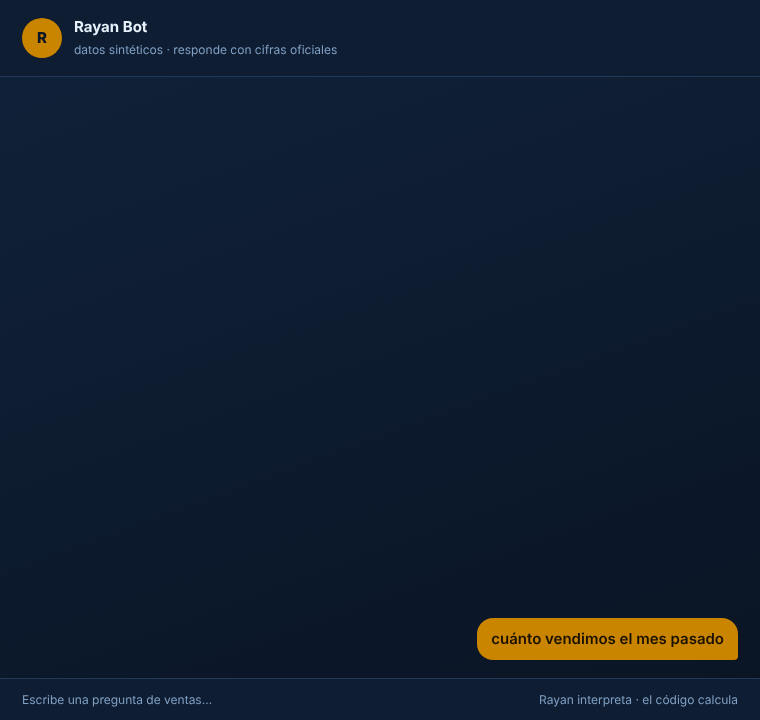
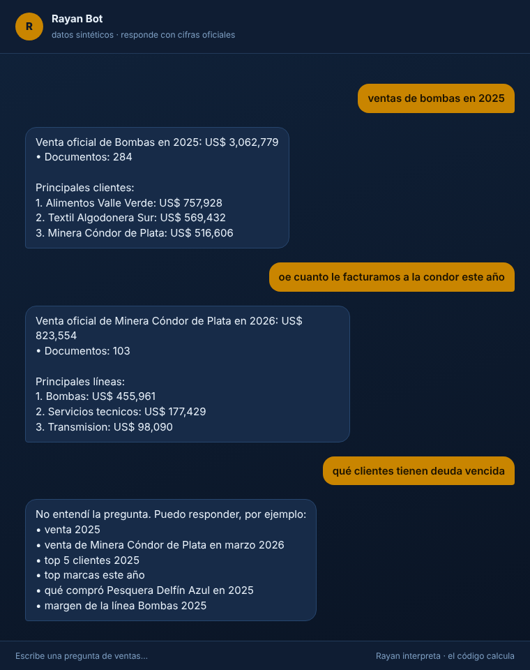
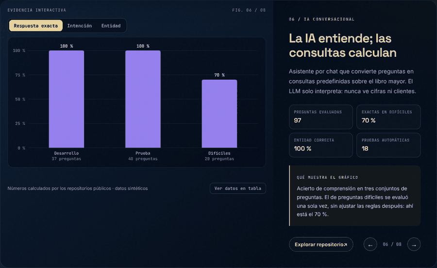
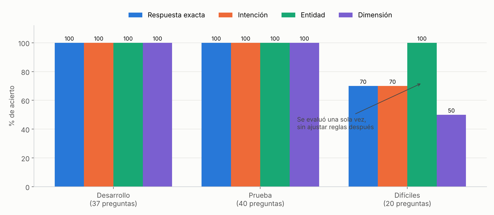

# Rayan Bot · Asistente comercial por chat (Telegram + API)

> **EN —** A chat assistant that answers sales questions from a phone (Telegram or REST API). An intent parser with transparent rules turns each question into a structured query. The optional LLM fallback only *interprets* the question and never sees the data. Every number comes from predefined, unit-tested queries over the official ledger, so it cannot hallucinate figures. It includes access control, ledger-vs-detail reconciliation and an evaluation harness with a held-out question set. **All data is synthetic.**

## Demo y capturas

Conversación real con el bot (datos sintéticos). La última pregunta no la entiende, y lo dice en vez de inventar:







> El mismo gráfico es **interactivo** en el [laboratorio de mi portafolio](https://dataross.vercel.app/#laboratorio): mueve los controles y se redibuja con los resultados de este repositorio.



*Acierto de comprensión en los tres conjuntos de preguntas.*

## El problema

Gerentes y vendedores necesitan cifras rápidas ("¿cuánto le vendimos a X este año?", "¿top 5 clientes?")
desde el celular. Los reportes estáticos tardan, y un chatbot de IA "libre" puede **inventar cifras**:
en ventas eso es inaceptable.

## La solución: la IA entiende, las consultas calculan

```
Telegram / API / terminal
        │
        ▼
 Control de acceso ──► usuario no autorizado = sin respuesta
        │
        ▼
 Interpretación:  reglas (intención + entidad + período + top N)
        │         └─ si no entiende y hay clave de IA → el LLM devuelve un JSON validado
        ▼            (solo recibe la pregunta: nunca ventas, clientes ni cifras)
 Consulta predefinida sobre los datos ──► respuesta con cifras auditables
        │
        └─ si el nombre es ambiguo → pregunta "¿a cuál te refieres?" en vez de adivinar
```

| Principio | Cómo se cumple |
|---|---|
| **No inventar cifras** | Las cifras salen solo de `queries.py`, y cada consulta tiene una prueba que la compara contra pandas |
| **Una sola verdad** | La venta oficial sale del libro mayor. El detalle comercial (artículos, marcas, márgenes) solo se usa para documentos que existen en el mayor |
| **Privacidad con IA** | Al LLM solo se le envía la pregunta. Una prueba verifica que no viajen cifras ni nombres del catálogo |
| **Nada sin validar** | El JSON del LLM se valida: la intención debe existir, y año, mes y límite deben estar en rango. La entidad se resuelve localmente |
| **Acceso controlado** | Solo usuarios activos en `usuarios.csv`. Se puede dar de baja a uno sin tocar el código |
| **Pedir aclaración en vez de adivinar** | "ventas de minera azul" → "¿Minera Quebrada Azul o Pesquera Delfín Azul?" |

## Qué puede responder

| Tipo | Ejemplos |
|---|---|
| Venta total | `venta 2025` · `cuánto facturamos en diciembre 2024` · `venta de este año` |
| Venta por cliente, vendedor, línea o marca | `cuánto le vendimos a minera condor en marzo 2026` · `ventas de Ana 2025` · `venta de hidrotek 2026` |
| Rankings | `top 5 clientes 2025` · `quiénes nos compran más este año` · `top 15 productos 2026` |
| Qué compró un cliente | `qué compró pesquera delfín azul en 2025` |
| Margen | `margen de la línea bombas 2025` · `rentabilidad de alimentos valle verde` |
| Comparación | `compara 2026 vs 2025`: en el año en curso compara el mismo período de ambos años |
| Resumen | `resumen` · `cómo vamos` |
| Conciliación | `concilia el mayor con el detalle de 2025`: diferencias documento por documento |
| Conceptos | `qué es el margen` · `qué es una nota de crédito` |

Entiende sin tildes, con errores de tipeo ("ventaz", "marjen"), nombres parciales ("la condor", "Ana") y
períodos relativos ("este año", "el año pasado", "el mes pasado").

## Evaluación de la comprensión (sin IA, solo reglas)

`python evaluate.py` mide, pregunta por pregunta, si el bot entendió la intención, la entidad, el período y el top N:

| Conjunto | Preguntas | Exactas | Entidad correcta | Nota |
|---|---|---|---|---|
| Desarrollo | 37 | 100 % | 100 % | Se usaron para escribir las reglas |
| Prueba | 40 | 100 % | 100 % | Escritas aparte, sin ajustar después |
| **Difíciles** | 20 | **70 %** | 100 % | Frases coloquiales, evaluadas **una sola vez** sin ajustar |

**Lectura honesta:** las tres listas las escribí yo, así que con usuarios reales el acierto será menor.
Las 6 fallas del conjunto difícil son de intención, nunca de entidad. Por ejemplo, "¿quién fue el mejor
vendedor del año pasado?" se entiende como venta total, y "¿cuánto cayeron las ventas de bombas?" como
venta de la línea en vez de una comparación. En esos casos el bot responde con una cifra correcta, pero a
otra pregunta. Siguientes pasos: registrar las preguntas reales de los usuarios, y llamar al LLM también
cuando las reglas tengan poca confianza, no solo cuando no entienden.

## Cómo probarlo

**Con doble clic (Windows):** `CHATEAR_CON_RAYAN.bat` abre el chat en una ventana. No necesitas Telegram ni claves.

**Desde la terminal:**

```bash
pip install -r requirements.txt
python chat.py                      # chat en la terminal
uvicorn rayan.api:app --reload      # API: http://127.0.0.1:8000/docs  (usuario de prueba: demo)
python evaluate.py                  # evaluación de comprensión
pytest -q                           # 18 pruebas
```

**Telegram (opcional):** copia `.env.example` como `.env`, pega el token de @BotFather, agrega tu usuario
de Telegram a `data/usuarios.csv` y abre `INICIAR_TELEGRAM.bat`. Para la IA, pon `LLM_API_KEY` (cualquier
API compatible con Chat Completions, como DeepSeek u OpenAI).

```
Tú:    cuanto le vendimos a minera condor en marzo 2026
Rayan: Venta oficial de Minera Cóndor de Plata en marzo 2026: US$ 112,922
       • Documentos: 11
       Principales líneas:
       1. Bombas: US$ 59,521
       2. Transmision: US$ 32,080
       3. Servicios tecnicos: US$ 19,099
```

## Estructura

```
rayan/
├── nlu.py           # normalización, períodos, top N, intención y resolución difusa de nombres
├── queries.py       # consultas predefinidas (cada una devuelve texto + datos auditables)
├── data.py          # carga, notas de crédito y regla mayor ↔ detalle
├── llm.py           # cliente LLM opcional + validación estricta del JSON
├── bot.py           # orquestador
├── access.py        # usuarios autorizados
├── glossary.py      # definiciones de negocio sin IA
├── api.py           # FastAPI
├── telegram_bot.py  # conector de Telegram
└── synthetic.py     # generador de datos de ejemplo
data/                # libro mayor, detalle, usuarios y preguntas de evaluación (todo sintético)
tests/               # cifras vs. pandas, seguridad de la IA, acceso, API, comprensión
```

## Datos

Todo es **sintético** (`rayan/synthetic.py`): 20 clientes, 6 vendedores y 7 marcas inventados, unas 4 mil
facturas de 2024 a 2026, notas de crédito, diferencias sembradas entre el mayor y el detalle, y documentos
comerciales que no llegaron al mayor. No se usa información de ninguna empresa real.

---
**Rosy Napuchi** · Business Intelligence & Data Science · [Portafolio](https://dataross.vercel.app/)
